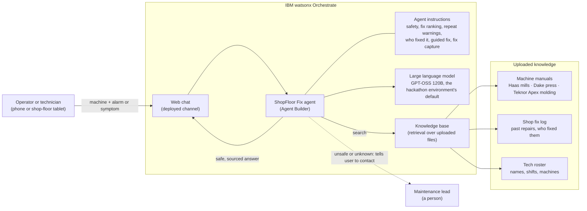
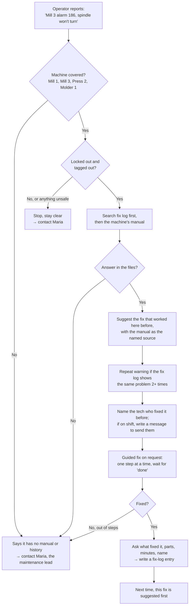
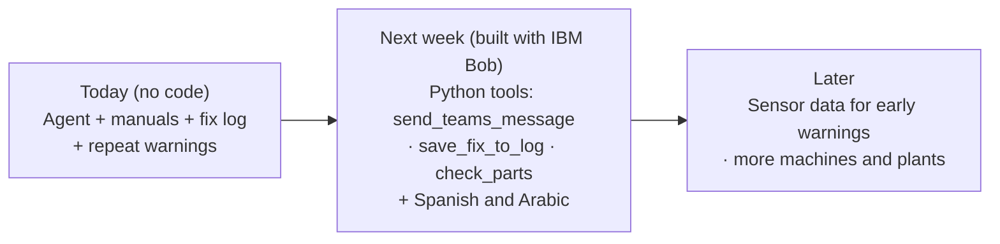

# ShopFloor Fix: Architecture

ShopFloor Fix is a single AI agent built without code in **IBM watsonx Orchestrate**. It answers from a small set of uploaded files (machine manuals, the shop's fix log and the tech roster) and follows a fixed set of instructions that put safety first and send anything unsafe or unknown to a person.

## System overview

## What happens in one conversation

## Components

| Component | What it is | What it does |
| --- | --- | --- |
| Web chat | watsonx Orchestrate deployed channel | Where the operator types; works on a phone or tablet |
| ShopFloor Fix agent | An agent built in watsonx Orchestrate Agent Builder | Runs the conversation and applies the instructions |
| Agent instructions | Plain-text rules in the agent's Behavior settings ([`agent/03_Agent_Instructions.txt`](agent/03_Agent_Instructions.txt)) | Decide the order of every answer: coverage check, safety, fix log, manual, repeat warning, people, guided fix, capture |
| Large language model | GPT-OSS 120B, the default model in the hackathon's watsonx Orchestrate environment | Understands the question and writes the answer from what the knowledge base returns |
| Knowledge base | watsonx Orchestrate knowledge (retrieval-augmented generation) | Searches the uploaded files so answers come only from them |
| Machine manuals | Public troubleshooting guides from Haas, Dake (Grand Haven, Michigan) and Teknor Apex; linked in the README, not stored here | The official fix steps and alarm meanings |
| Shop fix log | [`knowledge/01_Shop_Fix_Log.txt`](knowledge/01_Shop_Fix_Log.txt), fictional sample data | Past repairs: what worked, how long it took, who did it |
| Tech roster | [`knowledge/02_Tech_Roster.txt`](knowledge/02_Tech_Roster.txt), fictional sample data | Who works which shift and knows which machines |

## Design decisions

- **Safety before answers.** The agent gives no repair steps until the user confirms lockout/tagout, and sends anything unsafe to a person.
- **The shop's own history comes first.** A fix that worked in this shop beats generic manual advice, so the fix log is checked before the manual.
- **Answers only from the files.** The agent names its source and says "I don't know" instead of guessing. Questions about equipment it doesn't cover go to the maintenance lead.
- **People stay in charge.** The agent suggests, guides and drafts messages; a person decides, repairs and approves.
- **No sensors, no new hardware.** It works from documents and repair history that every shop already has, so a small shop can start the same day.
- **No code.** Everything is configured in watsonx Orchestrate, so a shop could maintain it without a developer.

## Known limits (what I didn't solve today)

- Messages to techs are written for the operator to send; they aren't sent automatically.
- New fix-log entries are written in the chat; they aren't saved straight back into the knowledge base.
- No live machine data; there are no sensors connected.

## Roadmap

### Next week: tools built with IBM Bob

Today's build is no-code. The next step is to use IBM Bob, IBM's AI development partner, to write Python tools and import them into the same watsonx Orchestrate agent, so it can take real actions instead of only drafting them:

| Tool | What it adds |
| --- | --- |
| `send_teams_message` | Messages the tech who fixed the problem before through Microsoft Teams, instead of writing a message for the operator to send |
| `save_fix_to_log` | Saves each new fix to a shared log, so the agent learns from every repair without anyone re-uploading files |
| `check_parts` | Checks the spare parts inventory and drafts a reorder to a Michigan supplier for the maintenance lead to approve |

The agent, its instructions and its knowledge stay the same; each tool plugs into the existing agent.

## Data and privacy

The shop (Great Lakes Fixture & Part Co.), its people and its repair history are fictional sample data. No personal or confidential information is used, and the repo contains no API keys or credentials.
